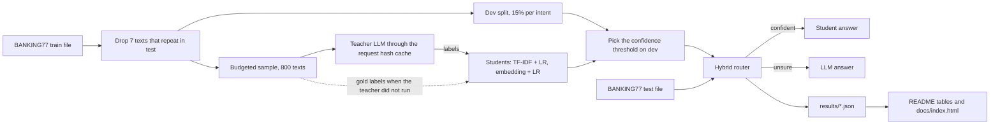

# distillroute

[](https://github.com/shreyas-tech7/distillroute/actions/workflows/ci.yml)

**Status:** release candidate `v0.1.0-rc1`. The pipeline, tests and report work offline. The teacher step and the LLM baseline did not run, because this build machine had no provider key and the provider hosts refused the connection. So every student below trained on gold labels. That shows training, not distillation. See [Limits](#limits).

## The problem

Many small companies send every support ticket to an LLM to pick a queue. Most tickets are easy. "Where is my card?" needs no large model. One call per ticket wastes money and adds latency.

distillroute trains a small numpy classifier on LLM labels. The classifier answers the tickets it is sure about and sends the rest to the LLM. Then it measures what that saves and what it costs in accuracy.

<!-- gen:headline -->
<!-- /gen:headline -->

## How it works



1. Load and split the data. The test file stays whole. The development split comes from the training file.
2. Get teacher labels through the fixture cache. Each request is hashed, and the raw response bytes are stored under that hash.
3. Train the students. Both use the same softmax regression, written in numpy.
4. Pick the hybrid threshold on the development split. The rule takes the lowest confidence at which the student is at least 95% right on the tickets it keeps.
5. Evaluate on the test split.
6. Build the report from the results files.

## Results

BANKING77 test split, 800 labeled training texts, seed 0:

<!-- gen:main -->
<!-- /gen:main -->

How to read the hybrid rows: the LLM answers did not run, so each hybrid row shows two bounds. The low bound counts every ticket sent to the LLM as wrong. The high bound counts every one as right. The real hybrid lands between them. Its cost uses the LLM price for the share sent to the LLM.

How the threshold was picked (on the development split, applied to test):

<!-- gen:hybrid -->
<!-- /gen:hybrid -->

The same pipeline on a second seed, to check the first run is not a lucky draw:

<!-- gen:second -->
<!-- /gen:second -->

The same pipeline with every training label (a company with a big labeled history):

<!-- gen:full -->
<!-- /gen:full -->

### How many labels are enough

<!-- gen:curve -->
<!-- /gen:curve -->

The curve is also drawn in [docs/index.html](docs/index.html#curve).

### What teacher noise does

<!-- gen:noise -->
<!-- /gen:noise -->

### Train time and memory

<!-- gen:timing -->
<!-- /gen:timing -->

### Second domain: synthetic small-business tickets

Written from scratch in `src/distillroute/synth.py`. About 15% of the tickets are vague on purpose, so no student can get them all right.

<!-- gen:synthetic -->
<!-- /gen:synthetic -->

## Cost per task

<!-- gen:cost -->
<!-- /gen:cost -->

The student's cost per ticket is tiny next to an LLM call. So the hybrid's cost is almost exactly the LLM price times the share it sends to the LLM. The one real lever is that share.

## Run it in 10 minutes

```bash
git clone https://github.com/shreyas-tech7/distillroute.git
cd distillroute
./init.sh                          # makes .venv, installs, lints, runs every test offline
.venv/bin/distillroute demo        # a fast run on the synthetic domain
.venv/bin/distillroute run         # BANKING77 and synthetic, writes results/
.venv/bin/distillroute curve       # learning curve and noise sweep, about 5 minutes
.venv/bin/distillroute timings     # train time and peak memory on 2 cores
.venv/bin/distillroute readme      # rewrites the tables above and docs/index.html
```

To record real teacher labels, put a key in the environment and run `distillroute record --provider groq` (or `openrouter` or `gemini`). The labels land in `fixtures/teacher/` under their request hash. The next `run` replays them byte for byte. A terminal transcript is in [docs/DEMO.md](docs/DEMO.md).

## Limits

- The teacher did not run. <!-- gen:record -->
<!-- /gen:record -->
  So the students trained on gold labels, and no row shows teacher agreement or real label noise. The noise table simulates it instead.
- The LLM-only baseline did not run. Its cost is an estimate from token counts and a dated price. Its accuracy and latency are unknown, so the hybrid shows bounds.
- The FastEmbed model could not download (Hugging Face and the model bucket refused the connection). The embedding student uses a hash embedder: hashed character n-grams. It is not a learned embedding. Install the `embed` extra and set `DISTILLROUTE_FASTEMBED=1` to use FastEmbed where it can download.
- Token counts are estimates at 4 characters per token, not a provider's tokenizer.
- Prices change. The price file records its source and the day it was read.
- One dataset is public and one is synthetic. Real queues have more vague tickets and drift over time.

## Data and license

<!-- gen:dataset -->
<!-- /gen:dataset -->

The code is MIT licensed. See [LICENSE](LICENSE).

## Glossary

- **Teacher:** the LLM that labels training texts.
- **Student:** the small classifier that learns from those labels.
- **Distillation:** training a small model on a large model's outputs.
- **Hybrid router:** the student answers when its confidence passes a threshold. Otherwise the ticket goes to the LLM.
- **Macro-F1:** the F1 score of each intent, averaged with equal weight. A model that ignores rare intents scores low even when its accuracy looks fine.
- **95% CI:** the range that would hold the true value in 95 of 100 repeats. Accuracy uses a Wilson interval. Macro-F1 uses a bootstrap.
- **Request hash:** the SHA-256 of the exact request. It names the cached response.
- **p50 latency:** the median time to answer one ticket.

## Related work

- [Distilling step-by-step](https://research.google/blog/distilling-step-by-step-outperforming-larger-language-models-with-less-training-data-and-smaller-model-sizes/) trains small models on LLM rationales.
- [SetFit](https://github.com/huggingface/setfit) fine-tunes small sentence-transformer models with few labels.
- [Snorkel](https://github.com/snorkel-team/snorkel) learns from weak, noisy labeling functions.
- [BANKING77](https://arxiv.org/abs/2003.04807) is the intent benchmark used here.

distillroute does not try to beat these. It measures the business trade-off directly: cost, latency and accuracy, with a fallback to the LLM where the student is unsure.

## How this was built

AI agents wrote most of the code under Shreyas's direction, from the brief in [docs/build/BUILD_PROMPT.md](docs/build/BUILD_PROMPT.md). Human checks, not done yet:

- Shreyas reads the diff and the results files.
- Shreyas runs record mode with a free key and checks the teacher rows.
- Shreyas checks the price file against the two price pages.

The design choices are in [DECISIONS.md](DECISIONS.md). A file by file tour is in [docs/WALKTHROUGH.md](docs/WALKTHROUGH.md).
