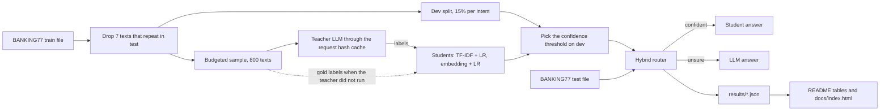

# distillroute

[](https://github.com/shreyas-tech7/distillroute/actions/workflows/ci.yml)

**Status:** release candidate `v0.1.0-rc1`. The pipeline, tests and report work offline. The teacher step and the LLM baseline did not run, because this build machine had no provider key and the provider hosts refused the connection. So every student below trained on gold labels. That shows training, not distillation. See [Limits](#limits).

## The problem

Many small companies send every support ticket to an LLM to pick a queue. Most tickets are easy. "Where is my card?" needs no large model. One call per ticket wastes money and adds latency.

distillroute trains a small numpy classifier on LLM labels. The classifier answers the tickets it is sure about and sends the rest to the LLM. Then it measures what that saves and what it costs in accuracy.

<!-- gen:headline -->
With 1100 labels (800 to train, 300 to set the threshold), the best student, Hash embedding + logistic regression, gets 65.2% accuracy on the BANKING77 test split. No confidence threshold passes the 95% rule on dev, so its hybrid sends every ticket to the LLM. With all 8498 training labels and 1498 dev labels, TF-IDF + logistic regression gets 86.0%. Its hybrid sends 37% of tickets to the LLM, and the tickets it keeps are 95.7% right on test, so it meets the 95% target.
<!-- /gen:headline -->

## How it works



1. Load and split the data. The test file stays whole. The development split comes from the training file.
2. Get teacher labels through the fixture cache. Each request is hashed, and the raw response bytes are stored under that hash.
3. Train the students. Both use the same softmax regression, written in numpy.
4. Pick the hybrid threshold on a labeled sample of the development split. The rule takes the lowest confidence at which the Wilson lower bound of the student's accuracy on the tickets it keeps reaches 95%. If no confidence passes, every ticket goes to the LLM, and the table says so. The dev labels count toward the label budget and come from the same source as the training labels.
5. Evaluate on the test split.
6. Build the report from the results files.

## Results

BANKING77 test split, 800 labeled training texts, seed 0:

<!-- gen:main -->
| System | Accuracy (95% CI) | Macro-F1 (95% CI) | Cost per 10,000 tickets | p50 latency | Sent to LLM |
| --- | --- | --- | --- | --- | --- |
| LLM only (gemini-3.1-flash-lite) | not run | not run | $1.26 (estimate) | not measured | 100% |
| TF-IDF + logistic regression | 60.2% (58.5% to 61.9%) | 58.8% (56.8% to 60.1%) | $0.000043 | 0.04 ms | 0% |
| Hash embedding + logistic regression | 65.2% (63.5% to 66.9%) | 63.9% (62.1% to 65.2%) | $0.000115 | 0.09 ms | 0% |
| Hybrid, TF-IDF + logistic regression first | 0.0% to 100.0% (bounds) | 0.0% to 100.0% (bounds) | $1.26 (estimate) | LLM latency (not measured) | 100.0% |
| Hybrid, Hash embedding + logistic regression first | 0.0% to 100.0% (bounds) | 0.0% to 100.0% (bounds) | $1.26 (estimate) | LLM latency (not measured) | 100.0% |

Run of 2026-11-21, seed 0, 800 labeled training texts and 300 labeled dev texts for the threshold (1100 labels in all), labels: gold (the teacher step did not run, so this shows training, not distillation). Students: numpy, hash embedder (FastEmbed model download blocked here, see BLOCKERS.md). Scored on the full test split (3080 tickets, 77 intents). CPU: Intel(R) Xeon(R) Processor @ 2.10GHz, cores [0, 1]. File `results/banking77-b800-seed0.json`.
<!-- /gen:main -->

How to read the hybrid rows: the LLM answers did not run, so each hybrid row shows two bounds. The low bound counts every ticket sent to the LLM as wrong. The high bound counts every one as right. The real hybrid lands between them. Its cost uses the LLM price for the share sent to the LLM. When the student keeps more than half the tickets, the hybrid's p50 latency is the student's. The slow tail belongs to the LLM calls, which were not measured.

How the threshold was picked (on the development split, applied to test):

<!-- gen:hybrid -->
| Student first | Threshold (from dev) | Kept accuracy on dev | Kept share on test | Kept accuracy on test (95% CI) | Test reaches 95% |
| --- | --- | --- | --- | --- | --- |
| TF-IDF + logistic regression | 0.99 | keeps none, target not met | 0.0% | keeps none | nothing kept |
| Hash embedding + logistic regression | 0.99 | keeps none, target not met | 0.0% | keeps none | nothing kept |

Rule: the lowest threshold whose Wilson lower bound of kept accuracy on the 300 dev tickets reaches 95%. When no threshold meets it, the router takes the highest one and the table says the target is not met.
<!-- /gen:hybrid -->

The same pipeline on a second seed, to check the first run is not a lucky draw:

<!-- gen:second -->
| System | Accuracy (95% CI) | Macro-F1 (95% CI) | Cost per 10,000 tickets | p50 latency | Sent to LLM |
| --- | --- | --- | --- | --- | --- |
| LLM only (gemini-3.1-flash-lite) | not run | not run | $1.26 (estimate) | not measured | 100% |
| TF-IDF + logistic regression | 60.6% (58.8% to 62.3%) | 59.3% (57.6% to 60.8%) | $0.000045 | 0.04 ms | 0% |
| Hash embedding + logistic regression | 65.9% (64.2% to 67.6%) | 64.9% (63.3% to 66.3%) | $0.000098 | 0.09 ms | 0% |
| Hybrid, TF-IDF + logistic regression first | 0.0% to 100.0% (bounds) | 0.0% to 100.0% (bounds) | $1.26 (estimate) | LLM latency (not measured) | 100.0% |
| Hybrid, Hash embedding + logistic regression first | 0.0% to 100.0% (bounds) | 0.0% to 100.0% (bounds) | $1.26 (estimate) | LLM latency (not measured) | 100.0% |

Run of 2026-11-21, seed 1, 800 labeled training texts and 300 labeled dev texts for the threshold (1100 labels in all), labels: gold (the teacher step did not run, so this shows training, not distillation). Students: numpy, hash embedder (FastEmbed model download blocked here, see BLOCKERS.md). Scored on the full test split (3080 tickets, 77 intents). CPU: Intel(R) Xeon(R) Processor @ 2.10GHz, cores [0, 1]. File `results/banking77-b800-seed1.json`.
<!-- /gen:second -->

The same pipeline with every training label (a company with a big labeled history):

<!-- gen:full -->
| System | Accuracy (95% CI) | Macro-F1 (95% CI) | Cost per 10,000 tickets | p50 latency | Sent to LLM |
| --- | --- | --- | --- | --- | --- |
| LLM only (gemini-3.1-flash-lite) | not run | not run | $1.26 (estimate) | not measured | 100% |
| TF-IDF + logistic regression | 86.0% (84.7% to 87.2%) | 86.0% (84.6% to 87.1%) | $0.008069 | 8.00 ms | 0% |
| Hash embedding + logistic regression | 85.6% (84.3% to 86.8%) | 85.5% (84.2% to 86.6%) | $0.000210 | 0.09 ms | 0% |
| Hybrid, TF-IDF + logistic regression first | 60.4% to 97.3% (bounds) | 59.9% to 97.3% (bounds) | $0.47 (estimate) | 8.00 ms | 36.9% |
| Hybrid, Hash embedding + logistic regression first | 57.4% to 98.1% (bounds) | 56.6% to 98.1% (bounds) | $0.51 (estimate) | 0.09 ms | 40.7% |

Run of 2026-11-21, seed 0, 8498 labeled training texts and 1498 labeled dev texts for the threshold (9996 labels in all), labels: gold (the teacher step did not run, so this shows training, not distillation). Students: numpy, hash embedder (FastEmbed model download blocked here, see BLOCKERS.md). Scored on the full test split (3080 tickets, 77 intents). CPU: Intel(R) Xeon(R) Processor @ 2.10GHz, cores [0, 1]. File `results/banking77-b8498-seed0.json`.
<!-- /gen:full -->

### How many labels are enough

<!-- gen:curve -->
| Student | Labeled examples | Accuracy, mean | Accuracy, range | Macro-F1, mean | Macro-F1, range |
| --- | --- | --- | --- | --- | --- |
| TF-IDF + logistic regression | 100 | 18.9% | 18.5% to 19.5% | 14.7% | 13.9% to 15.6% |
| TF-IDF + logistic regression | 250 | 34.3% | 32.8% to 35.6% | 30.6% | 29.2% to 32.2% |
| TF-IDF + logistic regression | 500 | 48.8% | 47.2% to 51.6% | 46.4% | 44.3% to 49.4% |
| TF-IDF + logistic regression | 800 | 60.2% | 58.2% to 63.6% | 58.9% | 57.1% to 62.6% |
| TF-IDF + logistic regression | 8498 | 86.0% | 86.0% to 86.0% | 86.0% | 86.0% to 86.0% |
| Hash embedding + logistic regression | 100 | 24.8% | 24.1% to 26.0% | 19.8% | 18.8% to 20.7% |
| Hash embedding + logistic regression | 250 | 41.1% | 39.7% to 41.9% | 37.0% | 34.7% to 38.8% |
| Hash embedding + logistic regression | 500 | 55.3% | 53.0% to 57.6% | 53.1% | 50.7% to 55.7% |
| Hash embedding + logistic regression | 800 | 65.4% | 63.8% to 67.4% | 64.4% | 63.0% to 66.6% |
| Hash embedding + logistic regression | 8498 | 85.6% | 85.6% to 85.6% | 85.5% | 85.5% to 85.5% |

Run of 2026-11-21, seeds [1, 2, 3], labels: gold (the teacher step did not run). Each point trains on a fresh seeded sample and scores on the full test split. The largest size is the whole training split. File `results/curve-banking77.json`.
<!-- /gen:curve -->

The curve is also drawn in [docs/index.html](docs/index.html#curve).

### What teacher noise does

<!-- gen:noise -->
| Student | Wrong labels | Accuracy, mean | Macro-F1, mean |
| --- | --- | --- | --- |
| TF-IDF + logistic regression | 0% | 60.2% | 58.9% |
| TF-IDF + logistic regression | 10% | 56.3% | 54.9% |
| TF-IDF + logistic regression | 20% | 52.1% | 50.9% |
| TF-IDF + logistic regression | 30% | 46.8% | 45.2% |
| Hash embedding + logistic regression | 0% | 65.4% | 64.4% |
| Hash embedding + logistic regression | 10% | 61.2% | 60.0% |
| Hash embedding + logistic regression | 20% | 57.0% | 56.0% |
| Hash embedding + logistic regression | 30% | 51.7% | 49.9% |

Training sets of 800 with a share of labels swapped for a random wrong intent, seeds [1, 2, 3]. This simulates a noisy teacher. It is not a real teacher. File `results/curve-banking77.json`.
<!-- /gen:noise -->

### Train time and memory

<!-- gen:timing -->
| Student | Training texts | Train time | Peak memory | Cores |
| --- | --- | --- | --- | --- |
| TF-IDF + logistic regression | 8498 | 36.6 s | 430 MB | [0, 1] |
| Hash embedding + logistic regression | 8498 | 7.6 s | 111 MB | [0, 1] |

Run of 2026-11-21 on Intel(R) Xeon(R) Processor @ 2.10GHz, fresh child process per student, pinned to cores 0 and 1 before numpy starts its threads, BLAS threads capped at 2, full training split. File `results/timings.json`.
<!-- /gen:timing -->

### Second domain: synthetic small-business tickets

Written from scratch in `src/distillroute/synth.py`. About 15% of the tickets are vague on purpose, so no student can get them all right.

<!-- gen:synthetic -->
| System | Accuracy (95% CI) | Macro-F1 (95% CI) | Cost per 10,000 tickets | p50 latency | Sent to LLM |
| --- | --- | --- | --- | --- | --- |
| LLM only (gemini-3.1-flash-lite) | not run | not run | $0.32 (estimate) | not measured | 100% |
| TF-IDF + logistic regression | 85.8% (78.5% to 91.0%) | 85.6% (78.4% to 90.9%) | $0.000066 | 0.03 ms | 0% |
| Hash embedding + logistic regression | 85.0% (77.5% to 90.3%) | 85.2% (78.5% to 90.4%) | $0.000174 | 0.09 ms | 0% |
| Hybrid, TF-IDF + logistic regression first | 83.3% to 96.7% (bounds) | 83.1% to 96.7% (bounds) | $0.04 (estimate) | 0.03 ms | 13.3% |
| Hybrid, Hash embedding + logistic regression first | 83.3% to 94.2% (bounds) | 83.3% to 94.2% (bounds) | $0.03 (estimate) | 0.09 ms | 10.8% |

Run of 2026-11-21, seed 0, 360 labeled training texts and 120 labeled dev texts for the threshold (480 labels in all), labels: gold (the teacher step did not run, so this shows training, not distillation). Students: numpy, hash embedder (FastEmbed model download blocked here, see BLOCKERS.md). Scored on the full test split (120 tickets, 12 intents). CPU: Intel(R) Xeon(R) Processor @ 2.10GHz, cores [0, 1]. File `results/synthetic-b360-seed0.json`.
<!-- /gen:synthetic -->

## Cost per task

<!-- gen:cost -->
LLM price: `gemini-3.1-flash-lite` at $0.25 per million input tokens and $1.5 per million output tokens (paid tier, Standard, text input), read on 2026-11-21 from https://ai.google.dev/gemini-api/docs/pricing. Tokens are estimated at 4 characters per token. One call has about 464 input tokens, and the 77 label names are most of them. Student price: the GitHub-hosted Linux 2-core (x64) runner at $0.006 per minute, read on 2026-11-21 from https://docs.github.com/en/billing/reference/actions-runner-pricing, times the measured mean time per ticket. Two one-time costs are left out of the per-ticket numbers. Labeling the 1100 training and dev texts once costs about $0.14 at the same LLM price. Training both students on the full split takes 44 s, about $0.004420 of runner time. These are comparison prices, not a bill.
<!-- /gen:cost -->

The student's cost per ticket is tiny next to an LLM call. So the hybrid's cost is almost exactly the LLM price times the share it sends to the LLM. The one real lever is that share.

## Run it in 10 minutes

```bash
git clone https://github.com/shreyas-tech7/distillroute.git
cd distillroute
./init.sh                          # makes .venv, installs, lints, runs every test offline
.venv/bin/distillroute demo        # a fast run on the synthetic domain
.venv/bin/distillroute run         # BANKING77 and synthetic, writes results/
.venv/bin/distillroute curve       # learning curve and noise sweep, about 5 minutes
.venv/bin/distillroute timings     # train time and peak memory on 2 cores
.venv/bin/distillroute readme      # rewrites the tables above and docs/index.html
```

To record real teacher labels, put a key in the environment and run `distillroute record --provider groq` (or `openrouter` or `gemini`). `record` labels the same training and dev samples that `run` uses for the same `--seed`, `--budget` and `--dev-budget`. The answers land in `fixtures/teacher/<dataset>/<model>/` under their request hash, with a `model.txt`. The next `run` with the same settings finds the model folder and replays the answers byte for byte. A recording that covers only part of a sample stops the run with an error, so it never quietly trains on gold. A terminal transcript is in [docs/DEMO.md](docs/DEMO.md).

## Limits

- The teacher did not run. <!-- gen:record -->
Record mode on 2026-11-23. gemini (gemini-3.1-flash-lite): blocked, no GEMINI_API_KEY in the environment, so no request was sent. groq (llama-3.1-8b-instant): blocked, no GROQ_API_KEY in the environment, so no request was sent. openrouter (meta-llama/llama-3.1-8b-instruct:free): blocked, no OPENROUTER_API_KEY in the environment, so no request was sent. File `results/record-status.json`.
<!-- /gen:record -->
  So the students trained on gold labels, and no row shows teacher agreement or real label noise. The noise table simulates it instead.
- The LLM-only baseline did not run. Its cost is an estimate from token counts and a dated price. Its accuracy and latency are unknown, so the hybrid shows bounds.
- The FastEmbed model could not download (Hugging Face and the model bucket refused the connection). The embedding student uses a hash embedder: hashed character n-grams. It is not a learned embedding. Install the `embed` extra and set `DISTILLROUTE_FASTEMBED=1` to use FastEmbed where it can download.
- Token counts are estimates at 4 characters per token, not a provider's tokenizer.
- Prices change. The price file records its source and the day it was read.
- One dataset is public and one is synthetic. Real queues have more vague tickets and drift over time.

## Data and license

<!-- gen:dataset -->
BANKING77 holds 13083 customer service queries in 77 intents. It is licensed under CC BY 4.0. Attribution: Casanueva, Temcinas, Gerz, Henderson and Vulic. Efficient Intent Detection with Dual Sentence Encoders. NLP4ConvAI workshop, ACL 2020. Data by PolyAI. Source: https://github.com/PolyAI-LDN/task-specific-datasets/tree/master/banking_data. Downloaded on 2026-11-21, unchanged, with SHA-256 hashes in `data/SOURCES.json`. The official train file repeats 7 test texts, and distillroute drops those 7 before it splits off the development set.
<!-- /gen:dataset -->

The code is MIT licensed. See [LICENSE](LICENSE).

## Glossary

- **Teacher:** the LLM that labels training texts.
- **Student:** the small classifier that learns from those labels.
- **Distillation:** training a small model on a large model's outputs.
- **Hybrid router:** the student answers when its confidence passes a threshold. Otherwise the ticket goes to the LLM.
- **Macro-F1:** the F1 score of each intent, averaged with equal weight. A model that ignores rare intents scores low even when its accuracy looks fine.
- **95% CI:** the range that would hold the true value in 95 of 100 repeats. Accuracy uses a Wilson interval. Macro-F1 uses a bootstrap.
- **Request hash:** the SHA-256 of the exact request. It names the cached response.
- **p50 latency:** the median time to answer one ticket.

## Related work

- [Distilling step-by-step](https://research.google/blog/distilling-step-by-step-outperforming-larger-language-models-with-less-training-data-and-smaller-model-sizes/) trains small models on LLM rationales.
- [SetFit](https://github.com/huggingface/setfit) fine-tunes small sentence-transformer models with few labels.
- [Snorkel](https://github.com/snorkel-team/snorkel) learns from weak, noisy labeling functions.
- [BANKING77](https://arxiv.org/abs/2003.04807) is the intent benchmark used here.

distillroute does not try to beat these. It measures the business trade-off directly: cost, latency and accuracy, with a fallback to the LLM where the student is unsure.

## How this was built

AI agents wrote most of the code under Shreyas's direction, from the brief in [docs/build/BUILD_PROMPT.md](docs/build/BUILD_PROMPT.md). Human checks, not done yet:

- Shreyas reads the diff and the results files.
- Shreyas runs record mode with a free key and checks the teacher rows.
- Shreyas checks the price file against the two price pages.

The design choices are in [DECISIONS.md](DECISIONS.md). A file by file tour is in [docs/WALKTHROUGH.md](docs/WALKTHROUGH.md).
